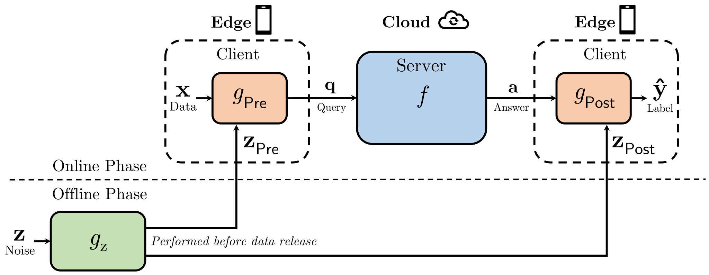

# CRISP

This is the implementation of the paper:

**CRISP: Leveraging Privacy Noise as Side Information to Break the Privacy–Accuracy Tradeoff in Edge–Cloud Inference**



CRISP turns privacy noise into useful side information: the server processes a privatized query, while the client uses its knowledge of the noise to recover an accurate prediction.

## Overview

Privacy noise protects client data, but it can also obscure the information needed for accurate inference.

CRISP addresses this tension through an information asymmetry: **the client knows the privacy noise, while the server does not**. A small client-side decoder exploits this knowledge to mitigate the noise in the returned prediction.

The framework combines three components:

- **Client preprocessing:** constructs a privatized query before transmission.
- **Server inference:** processes the query using a deep neural network.
- **Client post-processing:** combines the server response with noise-derived side information to recover the prediction.

A separate noise network prepares the side information and can run before the inference request.

In our MNIST experiment with **K = 16**, CRISP achieves **97.1% client accuracy**, while the evaluated adversary achieves **21.7% label-prediction accuracy**. More than **99% of the neural-network computation** is offloaded to the server.

## Our Contributions

### 1) Privacy Noise as Side Information

A client-side recovery design that:

- Uses knowledge of the privacy noise to improve prediction accuracy
- Learns noise mitigation and task prediction jointly
- Creates a path to accurate inference under strong privacy noise
- Avoids adversarial training

### 2) Information-Theoretic Privacy Guarantees

The paper establishes privacy bounds for:

- **Gaussian noise:** mutual-information leakage and strict differential privacy
- **Mixup noise:** maximum a posteriori label-inference success
- **Correlated queries:** Gaussian privacy bounds across multiple releases

These guarantees follow from the stated mathematical assumptions and do not depend on limiting adversary computational power.

### 3) Efficient Single-Server Inference

CRISP combines a standard server-side backbone with small client-side networks. The client retains the noise-derived side information locally, enabling prediction recovery with minimal additional computation.

**Communication cost is also low:** each inference requires only one privatized query upload and one compact server response. The noise-derived side information stays on the client, requiring no additional transmission.

## Pretrained Models

The pretrained model is available on Hugging Face:

👉 https://huggingface.co/hehteram/CRISP

The released checkpoint uses the **Mixup mechanism with K = 16**:

```text
models/model_mixup_16.pth
```

It contains the model state dictionary and can be loaded directly using the architecture defined in the notebook.

## Notebook Structure

The implementation is provided in a single Jupyter notebook:

```text
crisp.ipynb
```

### Outline

```text
Setup
    Libraries
    Seed and Hyperparameters
    Optional Google Drive Integration
    Device and Save/Load Helpers
Dataset
    Data Loading and Preprocessing
    Normalization
    Mixup and Gaussian Noise Generators
Privacy-Accuracy Trade-Off
    Network Architecture
    Network Costs
    Training Setup
    Optional Training
    Pretrained Model Evaluation
```

## Environment & Dependencies

### Python

Python 3 with compatible PyTorch and torchvision installations.

### Platform

- Google Colab with a GPU runtime
- A local or remote Jupyter environment with PyTorch
- CUDA-enabled GPU recommended; the notebook falls back to CPU when CUDA is unavailable

### Libraries

| Library | Purpose |
|---------|---------|
| torch | Neural networks, training, and inference |
| torchvision | Dataset loading and image transforms |
| numpy | Numerical operations |
| matplotlib | Visualization |
| huggingface_hub | Pretrained checkpoint download |
| torchinfo | Network summaries and computational costs |

Install missing dependencies in your Python environment:

```bash
pip install torch torchvision numpy matplotlib huggingface_hub torchinfo
```

For a GPU server, use a PyTorch installation compatible with its CUDA environment.

## Running the Code

1. Open `crisp.ipynb` in Google Colab or Jupyter.
2. In Colab, select **Runtime → Change runtime type → GPU**.
3. Run all cells sequentially.

## Reference

```bibtex
@misc{crisp_2026,
  title={CRISP: Leveraging Privacy Noise as Side Information to Break the Privacy–Accuracy Tradeoff in Edge–Cloud Inference},
  author={Anonymous},
  year={2026}
}
```

## Disclaimer

This repository is provided for research and reproducibility.
